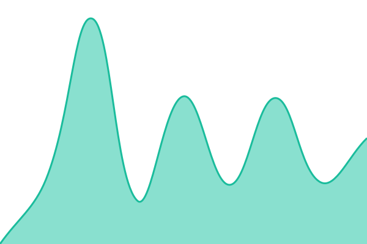
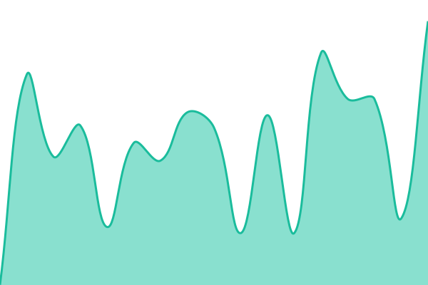
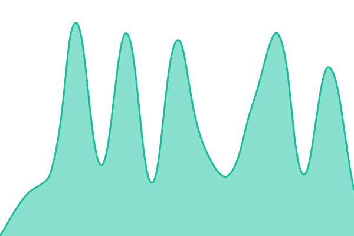
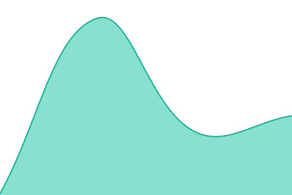

# [📈 Live Status](https://Minecraftgoose.github.io/status): <!--live status--> **🟧 Partial outage**

This repository contains the open-source uptime monitor and status page for [Minecraft_goose](https://blog.goose.cc.cd/), powered by [Upptime](https://github.com/upptime/upptime).

With [Upptime](https://upptime.js.org), you can get your own unlimited and free uptime monitor and status page, powered entirely by a GitHub repository. We use [Issues](https://github.com/Minecraftgoose/status/issues) as incident reports, [Actions](https://github.com/Minecraftgoose/status/actions) as uptime monitors, and [Pages](https://Minecraftgoose.github.io/status) for the status page.

<!--start: status pages-->
<!-- This summary is generated by Upptime (https://github.com/upptime/upptime) -->
<!-- Do not edit this manually, your changes will be overwritten -->
<!-- prettier-ignore -->
| URL | Status | History | Response Time | Uptime |
| --- | ------ | ------- | ------------- | ------ |
|  [GooseHost](https://host.goose.cc.cd/) | 🟩 Up | [goose-host.yml](https://github.com/Minecraftgoose/status/commits/HEAD/history/goose-host.yml) | 

 1588ms
     
 | 

<a href="https://Minecraftgoose.github.io/status/history/goose-host">100.00%</a>
    

|  [GooseHost托管站点访问](https://page.goose.cc.cd/md/cli) | 🟩 Up | [goose-host.yml](https://github.com/Minecraftgoose/status/commits/HEAD/history/goose-host.yml) | 

 1588ms
     
 | 

<a href="https://Minecraftgoose.github.io/status/history/goose-host">100.00%</a>
    

|  [GooseHost-PHP](https://host.goose.l.cd/) | 🟥 Down | [goose-host-php.yml](https://github.com/Minecraftgoose/status/commits/HEAD/history/goose-host-php.yml) | 

 0ms
     
 | 

<a href="https://Minecraftgoose.github.io/status/history/goose-host-php">0.00%</a>
    

|  [GooseHost-PHP托管站点访问](https://page.goose.l.cd/s/localstorage) | 🟥 Down | [goose-host-php.yml](https://github.com/Minecraftgoose/status/commits/HEAD/history/goose-host-php.yml) | 

 0ms
     
 | 

<a href="https://Minecraftgoose.github.io/status/history/goose-host-php">0.00%</a>
    

|  [GooseBlog主站](https://blog.goose.cc.cd/) | 🟩 Up | [goose-blog.yml](https://github.com/Minecraftgoose/status/commits/HEAD/history/goose-blog.yml) | 

 675ms
     
 | 

<a href="https://Minecraftgoose.github.io/status/history/goose-blog">100.00%</a>
    

|  [GooseBlog副站](https://blog.cyann.top/) | 🟩 Up | [goose-blog.yml](https://github.com/Minecraftgoose/status/commits/HEAD/history/goose-blog.yml) | 

 675ms
     
 | 

<a href="https://Minecraftgoose.github.io/status/history/goose-blog">100.00%</a>
    

|  [mciconsCDN](https://mcicons.netlify.app/) | 🟩 Up | [mcicons-cdn.yml](https://github.com/Minecraftgoose/status/commits/HEAD/history/mcicons-cdn.yml) | 

 670ms
     
 | 

<a href="https://Minecraftgoose.github.io/status/history/mcicons-cdn">100.00%</a>
    

|  [GooseHyperGlassCDN-主](https://glass.goose.cc.cd/) | 🟩 Up | [goose-hyper-glass-cdn.yml](https://github.com/Minecraftgoose/status/commits/HEAD/history/goose-hyper-glass-cdn.yml) | 

 429ms
     
 | 

<a href="https://Minecraftgoose.github.io/status/history/goose-hyper-glass-cdn">100.00%</a>
    

|  [GooseHyperGlassCDN-备](http://glass.goose.bbroot.com/) | 🟩 Up | [goose-hyper-glass-cdn.yml](https://github.com/Minecraftgoose/status/commits/HEAD/history/goose-hyper-glass-cdn.yml) | 

 429ms
     
 | 

<a href="https://Minecraftgoose.github.io/status/history/goose-hyper-glass-cdn">100.00%</a>
    

|  [macOS网页版](https://macos.goose.cc.cd/) | 🟩 Up | [mac-os.yml](https://github.com/Minecraftgoose/status/commits/HEAD/history/mac-os.yml) | 

 595ms
     
 | 

<a href="https://Minecraftgoose.github.io/status/history/mac-os">100.00%</a>
    

|  [网站图标抓取服务](https://favicon.cyann.top/) | 🟥 Down | [网站图标抓取服务.yml](https://github.com/Minecraftgoose/status/commits/HEAD/history/网站图标抓取服务.yml) | 

 87ms
     
 | 

<a href="https://Minecraftgoose.github.io/status/history/网站图标抓取服务">0.00%</a>
    

<!--end: status pages-->

[**Visit our status website →**](https://Minecraftgoose.github.io/status)

## 📄 License

- Powered by: [Upptime](https://github.com/upptime/upptime)
- Code: [MIT](./LICENSE) © [Anand Chowdhary](https://anandchowdhary.com)
- Data in the `./history` directory: [Open Database License](https://opendatacommons.org/licenses/odbl/1-0/)
