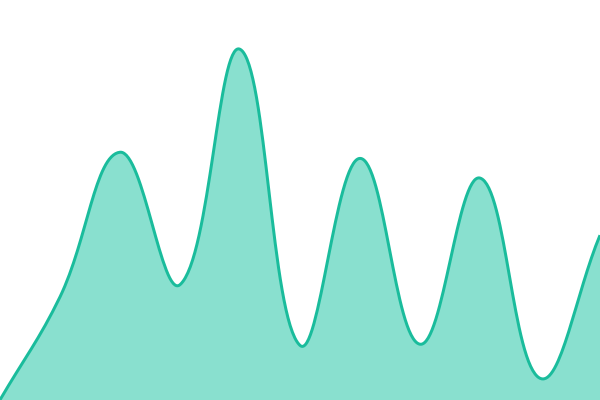
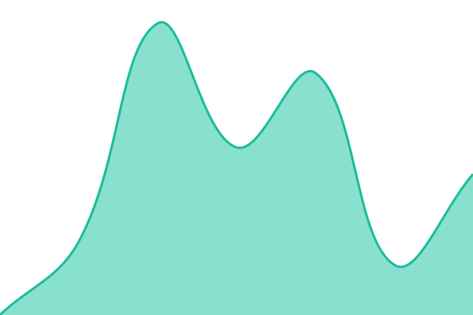
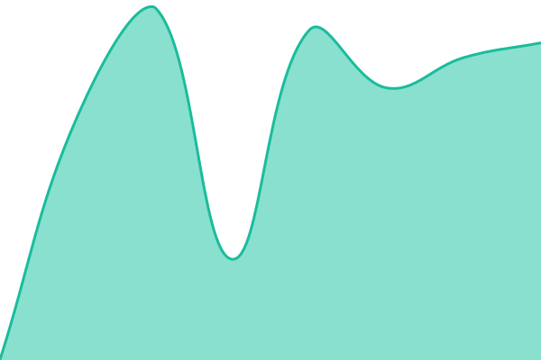
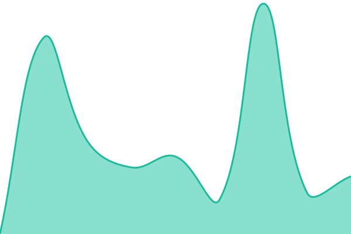
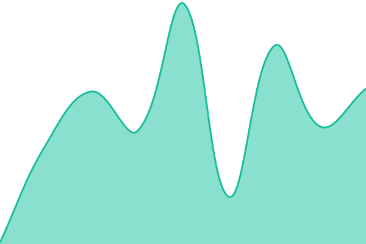

# [📈 实时状态](https://Minecraftgoose.github.io/status)：<!--live status--> **部分服务中断**

本仓库是 [Minecraft_goose](https://blog.goose.cc.cd/) 的开源可用性监控与状态页，由 [Upptime](https://github.com/upptime/upptime) 提供支持。

借助 [Upptime](https://upptime.js.org)，你可以免费搭建不限数量的可用性监控与状态页，全部由 GitHub 仓库驱动。我们用 [Issues](https://github.com/Minecraftgoose/status/issues) 记录事件报告，用 [Actions](https://github.com/Minecraftgoose/status/actions) 作为可用性探针，用 [Pages](https://Minecraftgoose.github.io/status) 承载状态页面。

<!--start: status pages-->
<!-- This summary is generated by Upptime (https://github.com/upptime/upptime) -->
<!-- Do not edit this manually, your changes will be overwritten -->
<!-- prettier-ignore -->
| 站点 | 状态 | 历史 | 响应时间 | 可用率 |
| --- | ------ | ------- | ------------- | ------ |
|  [GooseHost](https://host.goose.cc.cd/) | 正常 | [goose-host.yml](https://github.com/Minecraftgoose/status/commits/HEAD/history/goose-host.yml) | 

 1317ms
     
 | 

<a href="https://status.goose.cc.cd/history/goose-host">100.00%</a>
    

|  [GooseHost托管站点访问](https://page.goose.cc.cd/md/cli) | 正常 | [goose-host.yml](https://github.com/Minecraftgoose/status/commits/HEAD/history/goose-host.yml) | 

 1317ms
     
 | 

<a href="https://status.goose.cc.cd/history/goose-host">100.00%</a>
    

|  [GooseHost-PHP](https://host.goose.l.cd/) | 中断 | [goose-host-php.yml](https://github.com/Minecraftgoose/status/commits/HEAD/history/goose-host-php.yml) | 

 0ms
     
 | 

<a href="https://status.goose.cc.cd/history/goose-host-php">0.00%</a>
    

|  [GooseHost-PHP托管站点访问](https://page.goose.l.cd/s/localstorage) | 中断 | [goose-host-php.yml](https://github.com/Minecraftgoose/status/commits/HEAD/history/goose-host-php.yml) | 

 0ms
     
 | 

<a href="https://status.goose.cc.cd/history/goose-host-php">0.00%</a>
    

|  [GooseBlog主站](https://blog.goose.cc.cd/) | 正常 | [goose-blog.yml](https://github.com/Minecraftgoose/status/commits/HEAD/history/goose-blog.yml) | 

 730ms
     
 | 

<a href="https://status.goose.cc.cd/history/goose-blog">100.00%</a>
    

|  [GooseBlog副站](https://blog.cyann.top/) | 正常 | [goose-blog.yml](https://github.com/Minecraftgoose/status/commits/HEAD/history/goose-blog.yml) | 

 730ms
     
 | 

<a href="https://status.goose.cc.cd/history/goose-blog">100.00%</a>
    

|  [mciconsCDN](https://mcicons.netlify.app/) | 正常 | [mcicons-cdn.yml](https://github.com/Minecraftgoose/status/commits/HEAD/history/mcicons-cdn.yml) | 

 717ms
     
 | 

<a href="https://status.goose.cc.cd/history/mcicons-cdn">100.00%</a>
    

|  [GooseHyperGlassCDN-主](https://glass.goose.cc.cd/) | 正常 | [goose-hyper-glass-cdn.yml](https://github.com/Minecraftgoose/status/commits/HEAD/history/goose-hyper-glass-cdn.yml) | 

 391ms
     
 | 

<a href="https://status.goose.cc.cd/history/goose-hyper-glass-cdn">100.00%</a>
    

|  [GooseHyperGlassCDN-备](http://glass.goose.bbroot.com/) | 正常 | [goose-hyper-glass-cdn.yml](https://github.com/Minecraftgoose/status/commits/HEAD/history/goose-hyper-glass-cdn.yml) | 

 391ms
     
 | 

<a href="https://status.goose.cc.cd/history/goose-hyper-glass-cdn">100.00%</a>
    

|  [macOS网页版](https://macos.goose.cc.cd/) | 正常 | [mac-os.yml](https://github.com/Minecraftgoose/status/commits/HEAD/history/mac-os.yml) | 

 329ms
     
 | 

<a href="https://status.goose.cc.cd/history/mac-os">100.00%</a>
    

|  [网站图标抓取服务](https://favicon.cyann.top/) | 中断 | [网站图标抓取服务.yml](https://github.com/Minecraftgoose/status/commits/HEAD/history/网站图标抓取服务.yml) | 

 96ms
     
 | 

<a href="https://status.goose.cc.cd/history/网站图标抓取服务">0.00%</a>
    

<!--end: status pages-->

[**访问我们的状态页 →**](https://Minecraftgoose.github.io/status)

## 📄 许可证

- 技术支持：[Upptime](https://github.com/upptime/upptime)
- 代码：[MIT](./LICENSE) © [Anand Chowdhary](https://anandchowdhary.com)
- `./history` 目录中的数据：[开放数据库许可协议](https://opendatacommons.org/licenses/odbl/1-0/)
